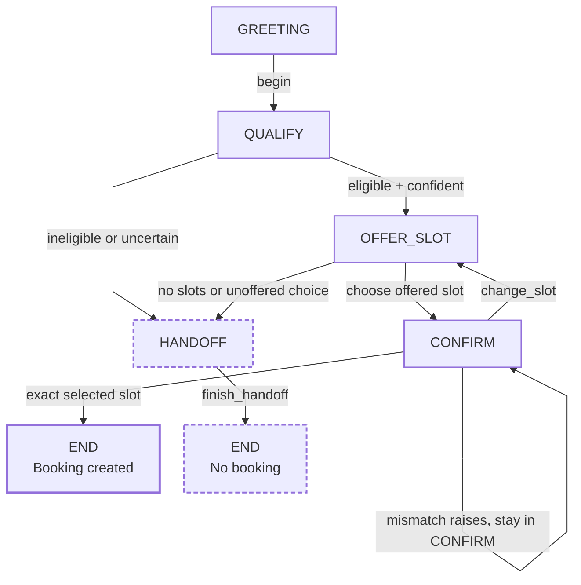

# AI Booking Workflow

Imagine asking an automated receptionist for 2 PM after it offered you **10 AM or 11 AM**.

A confident chatbot might just say, "Booked!" I would rather it admit it can't do that.

This Python project is the boring but important part of a booking assistant: a state machine where the assistant can only confirm a slot that actually came from its offered list.

## Follow one booking

`GREETING → QUALIFY → OFFER_SLOT → CONFIRM → END`

The happy path is straightforward. The interesting part is everything that must **not** turn into a booking:

- The caller doesn't qualify or the system isn't confident? **Handoff.**
- No slots supplied? **Handoff**, not invented availability.
- Caller chooses a time that wasn't offered? **Handoff.**
- Confirmation doesn't match the selected time? **Error, no booking.**
- Caller changes their mind? Clear the selection and go back to the offered slots.

My favourite feature is the absence of imaginary appointments.

The code behind this: [state transitions](src/booking_workflow/fsm.py), [slot cleanup](src/booking_workflow/availability.py), [guardrails](src/booking_workflow/guardrails.py), and [tests](tests/).

## The state machine, on one page

There is exactly one path to a booking value. Everything else either changes the selection or refuses to pretend.

The [behavior tests](docs/verification.md) cover the normal path and the ways a booking can be rejected.

There's also a [state table](docs/state-table.md) if you want to inspect the transitions one by one.

### Don't mistake a state machine for a calendar

The outcome here is a Python `Booking` value. There is **no provider SDK, persistent booking, live availability check, or final stale-slot revalidation**. A real integration would still need a fresh availability check and a safe external write. [Provenance](PROVENANCE.md) · [verification](docs/verification.md).
