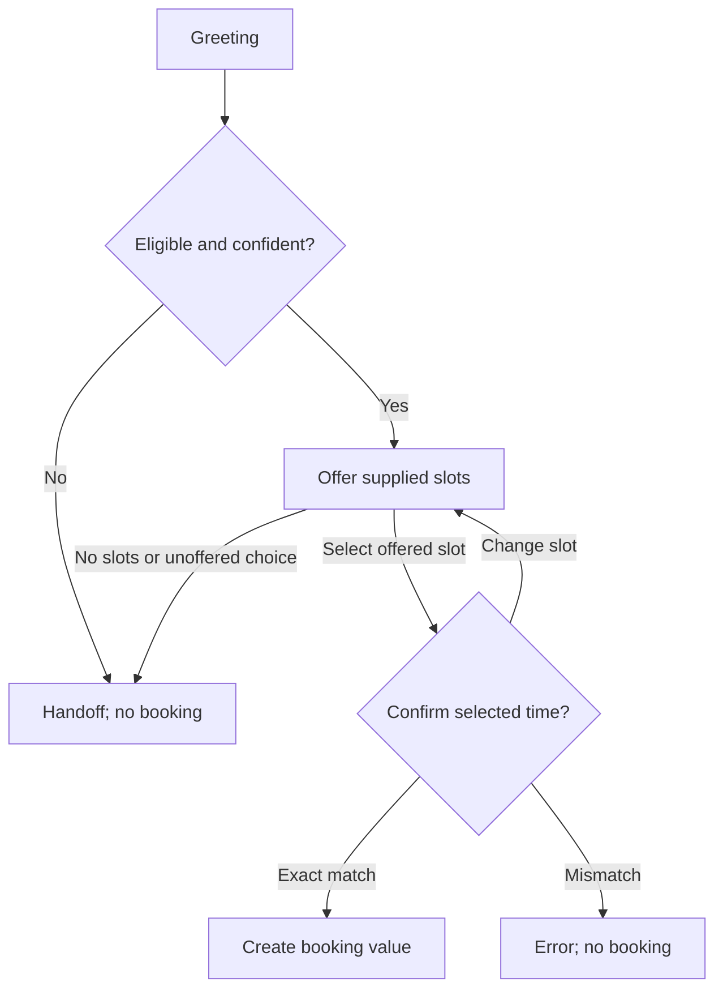

# AI Booking Workflow

Imagine a caller asking for **2 PM** when the assistant has only offered **10 AM and 11 AM**.

An overly helpful chatbot can say “Booked!” with such confidence that you'd almost believe a calendar was involved. Unfortunately, the appointment exists exclusively in the chatbot's imagination.

This Python **state machine** doesn't get to invent appointments on its own. It creates a booking value only when the caller confirms a time the workflow actually offered.

## A short list of appointments we are not making

The normal sequence is **greeting → qualification → offer → confirmation → end**.

| Caller or system does this | What the state machine does |
| --- | --- |
| No availability supplied | Handoff; no invented appointment |
| Caller fails qualification or confidence threshold | Handoff |
| Caller selects an unoffered time | Handoff; don't invent availability |
| Caller selects an offered time, then changes their mind | Clear selection and return to offered slots |
| Confirmation differs from selected time | Error; don't create a booking |
| Caller confirms the selected, offered time | Create a Python booking value |

There is only one path that creates a booking value: selecting and confirming a time that was actually offered. Here's the whole decision in one picture; the table above covers the awkward details.

The code is split across [state transitions](src/booking_workflow/fsm.py), [availability cleanup](src/booking_workflow/availability.py), and [guardrails](src/booking_workflow/guardrails.py). Read the [state table](docs/state-table.md) for exact transitions and [behavior tests](docs/verification.md) for rejection cases.

## Important: “booking value” ≠ “calendar booking”

There is **no live calendar, provider SDK, database-backed reservation, final stale-slot revalidation, or external booking write** in this repository. It's a tested state machine, not a deployed receptionist.

A real booking integration would need fresh availability and a safely verified write. A Python object is not a dentist's schedule, no matter how enthusiastic the chatbot sounds. [Provenance](PROVENANCE.md) · [verification](docs/verification.md).
